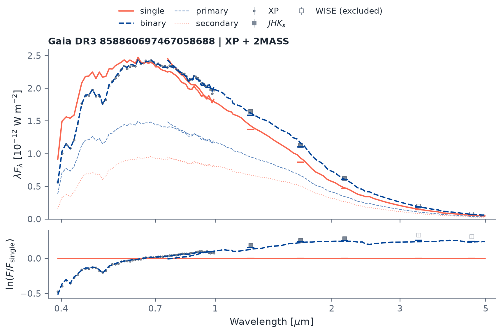

# spbin

<div class="hero" markdown>

## Absolute-flux SED modelling for stars and binaries

Connect Gaia XP, infrared photometry and optional SPHEREx spectra to physical stellar models. Compare single stars and binaries, study compact companions, and connect their light to Gaia photocentre orbits.

从 Gaia XP 和红外数据出发，在实际距离下拟合恒星与双星，分析白矮星、热亚矮星及其伴星，并连接 Gaia 光心轨道。

[Get started](en/getting-started.md){ .md-button .md-button--primary }
[中文文档](zh/getting-started.md){ .md-button }
[API reference](en/api.md){ .md-button }

</div>



Observed Gaia XP and infrared measurements with single-star and binary models. See the [quickstart](en/getting-started.md) and [model reference](model.md) for the fit conventions.

## One source, one fit

```bash
python -m pip install "spbin[download] @ git+https://github.com/jiadonglee/spbin.git"
```

```python
from spbin import download, fit, plot

sed = download("858860697467058688", cache_dir="data")
result = fit(sed, age_gyr=5.0, feh=0.0)
fig = plot(sed, result, path="sed.png")
```

## Explore the package

| Task | Documentation |
| --- | --- |
| Acquire Gaia and SPHEREx measurements | [Data and downloads](en/data.md) |
| Fit single stars and coeval binaries | [Stellar fitting](en/stellar.md) |
| Model giants, hot subdwarfs and DA white dwarfs | [Companion models](en/companions.md) |
| Connect SEDs to photocentre orbits | [Orbits and joint likelihoods](en/orbits.md) |
| Check parameters, defaults and return fields | [API signatures](en/api.md), [fitting API](en/stellar.md) |
| Assess scientific evidence and applicability | [Validation](en/validation.md), [limitations](en/limitations.md) |

Core fitting runs on NumPy and SciPy with bundled model assets. Package version: **0.2.0**.

[Source code](https://github.com/jiadonglee/spbin) · [Report an issue](https://github.com/jiadonglee/spbin/issues) · [License](https://github.com/jiadonglee/spbin/blob/main/LICENSE)
