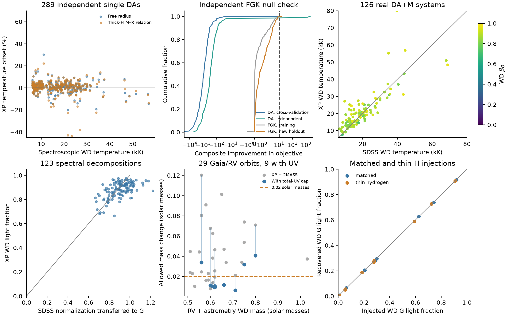

# White-dwarf validation

The DA route measures `beta_G = F_WD/(F_primary+F_WD)` and conditional
light envelopes for photocentre-orbit calculations. Validation below
uses the bundled `WhiteDwarfModel()`: Koester DA spectra calibrated on
the absolute XP flux of real single DAs, with Bédard C/O-core cooling
tracks. The criteria were recorded before fitting in the WD plan.
The composite-detection thresholds of `fit_whitedwarf_companion` and of
the main-sequence region of `fit_star` are calibrated on this model.

## Anchors and availability

Gaia EDR3 identifiers are joined directly to DR3 `has_xp_continuous`.
SDSS plate/MJD/fibre IDs use the proper-motion-aware crossmatch of
Gentile Fusillo et al. (2021). Brightness does not replace the XP flag:
DR3 contains an additional faint WD selection.

| Reference | Parameter rows | With XP | DA candidates in the model box |
| --- | ---: | ---: | ---: |
| Manser et al. (2024), DESI DA | 1958 | 1043 | 974 |
| Kepler et al. (2021), SDSS DR16 | 555 | 425 | 416 |
| Gianninas et al. (2011), MWDD | 1264 | 1240 | 1210 |
| Kilic et al. (2025), MWDD | 3146 | 3060 | photometric labels |
| Manser et al. (2024), DESI DB | 141 | 65 | outside the DA route |

The spectroscopic DA union has 2524 distinct sources, 2064 with
Teff >= 13 kK or catalogue 3D-corrected labels, and 2005 also passing
RUWE < 1.4 and parallax/error > 10. These counts define availability.
Kilic labels are photometric. SDSS DR16 gravities use a Gaia parallax
constraint and omit 3D corrections; they are excluded from the
spectroscopic calibration cohort.

Additional checks find XP for 14852 of 16676 Gentile Fusillo high-probability
(Pwd > .75), parallax > 10 mas candidates, and for all 9786 sources in
the Shahaf non-class-I parent catalogue. The latter includes classes II
and III, rather than exclusively class III or RV-confirmed WDs.
The [updated Shahaf table](https://zenodo.org/records/14799795) uses a
64% red-probability threshold, giving 3145 no-colour-excess candidates;
all have XP. The Nayak et al. (2024) sample is photometrically selected,
not independent XP spectral decomposition, and is not included in the
calibration or measured coverage counts.

The SDSS WDMS comparison uses 478 distinct Gaia IDs matched by spectrum
key to the author catalogue; 170 have XP and 156 have atmospheric labels
within the DA box. The tested subset has 126 exact DA/M classifications,
a reported M subtype and parallax/error > 10. It is not the full SDSS
WDMS population.

## Single DA calibration

The calibration uses 294 single DAs within 100 pc at |b| > 30 degrees
with DESI or Gianninas spectral labels, Gaia parallax and native
Edenhofer extinction; 289 independent DAs at 100--150 pc with a
reference mass test it. Known double stars are excluded. Cool labels
use available 3D corrections, and folds are grouped by source ID.
The correction is linear between seven knots in log Teff (7--80 kK)
with a linear gravity term; it is fitted to absolute XP flux at the
spectral labels and keeps each source's normalization. The out-of-fold,
grey-normalized shape RMS is 6.20%. The absolute XP flux has median
offset −0.22% and source scatter 10.1% out of fold, and +1.88% and
13.9% on the independent stars.

| Fit | Sample | Median Teff offset | Robust scatter |
| --- | --- | ---: | ---: |
| Free radius | 294, out of fold | +0.61% | 3.86% |
| Thick-H mass–radius relation | 294, out of fold | +0.86% | 3.99% |
| Free radius | 289 independent | +1.22% | 3.36% |
| Thick-H mass–radius relation | 289 independent | +1.40% | 3.54% |

The mass–radius fits use extinction priors and catalogue parallax
constraints and no spectral-label prior. Their mass offset is +0.013
solar masses with scatter 0.039 out of fold and +0.009 with scatter
0.053 on the independent stars. The reference mass is implied by
spectral Teff/log g and the same cooling tracks; it is not a dynamical
mass. The results meet the median-temperature <= 3%, scatter <= 8% and
mass-scatter <= 0.08 criteria.

On the independent stars the mass–radius temperature offset is
+1.95% (scatter 2.76%) for 105 stars below 13 kK, +0.83% (3.97%) for
128 at 13--25 kK and +1.39% (4.15%) for 48 at 25--40 kK. The eight
stars above 40 kK give −6.9% and 8.8%; the calibration does not
establish hot-WD precision.

A physical-model comparison uses 84 pure-H
[TLUSTY207 NLTE nodes](https://archive.stsci.edu/hlsp/wd-grid) at 30--80 kK,
log g 7--9.5, through the same XP forward operator. On seven hot
spectroscopic anchors, raw Koester and raw TLUSTY spectra give
temperature biases +17.9% and +19.8% with robust scatters 12.6% and
11.8%; two raw TLUSTY fits reach the 80-kK grid boundary. Neither
atmosphere family reaches 3% hot-temperature precision on XP; the runtime
atmosphere remains the calibrated DA table.

## Blue XP and GALEX

The six XP channels at 332--382 nm carry their own calibrated correction
and shape error. They are optional and are not validated as a default
for composites: on the SDSS WD+M systems below, adding them changes the
WD temperature scatter from 14.88% to 16.18%.

The bundled FUV/NUV passband corrections come from 71 training DAs with
clean GALEX measurements (61 FUV, 57 NUV), fitted at the spectral labels,
cooling radius, Gaia parallax and native extinction. The log corrections
are −0.206 (FUV) and −0.071 (NUV), with fractional model errors 11.6%
and 15.1%. The anchors cover 6.8--41.4 kK. Matches propagate Gaia
positions to 2007 and require proper motion < 80 mas/yr, one candidate
within 3 arcsec, no artifact/extraction flags, unsaturated magnitudes
and magnitude errors < 0.2. GALEX is not supplied by default. Outside
the tested temperature range, the UV likelihood uses an adopted 0.5
fractional model-error floor.

## Null checks and composite recovery

The detection statistic of `fit_whitedwarf_companion` is the better
single-star objective minus the composite objective. Its threshold of 11
is the first integer above the maximum statistic of 230 APOGEE
RV-constant training controls, fitted on XP with free age and
metallicity under a spectroscopic metallicity prior, a dust-map
extinction prior and a fitted parallax. The independent sample contains
200 new Gaia IDs, within 150 pc and |b| > 30 degrees, with 4500--7000 K,
log g > 4.1, at least five good RVs, RV scatter < 0.3 km/s and S/N > 100.
It shares no IDs with the training sample. The DA samples are fitted
with their native extinction priors.

| Sample | Above 11 | One-sided 95% binomial upper bound |
| --- | ---: | ---: |
| 294 training DAs, out-of-fold calibration | 0 | 1.01% |
| 289 independent DAs | 4 | 3.14% |
| 230 training FGK controls | 0 | 1.29% |
| 200 independent FGK controls | 1 | 2.35% |

The independent samples give false-positive rates of 1.4% (DAs) and
0.5% (FGK), but their 95% upper bounds exceed the 2% control-sample
criterion. RV constancy and a DA classification do not prove that every
control lacks a companion. The threshold applies to XP fits with these
nuisance priors.

On 126 SDSS DA/M systems, default solar-metallicity, 5-Gyr dwarf fits
give a WD temperature offset of −0.86% and robust scatter 13.90%, meeting
the 15% temperature criterion. Using the Pecaut/Mamajek temperature
scale, inferred M subtype has a +0.62-subclass median offset and
0.99-subclass robust scatter; 75/126 lie within one subclass. A reliable
one-subclass estimate for every companion is not established.
Only 39 systems have an accepted 2MASS band. Adding those data (14.88%
scatter) or freeing the WD radius under a spectral gravity prior (16.35%)
does not improve the full-sample temperature scatter. Broadening the extinction prior from 0.03 to
0.10 E gives 20.12% WD temperature scatter and 76/126 subtypes within one
subclass. Fitting metallicity with a 0.0 +/- 0.3 dex prior reduces the
median subtype offset to +0.07 but increases its scatter to 1.19
subclasses (75/126 within one); WD temperature scatter rises to 19.67%,
with +3.55% median bias.
The detection statistic exceeds 11 for 99/126; this is a catalogue-subset
recovery fraction, not population completeness.

For 123 systems with usable SDSS WD decomposition distances, transfer
its WD angular normalization to Gaia G using the DA spectral shape.
The median XP-minus-reference fraction is −0.0220, robust scatter
0.0851, and 54/123 agree within 0.05. The median-bias criterion is met.
Twenty-three normalization estimates exceed unity, showing the uncertainty
and cross-observation systematics of this reference; they remain in the
reported comparison and are not physical WD fractions. This normalization
is independent of Gaia parallax but shares a DA atmosphere family;
it is not independent atmospheric-model validation.
Observed XP covers all but 0.37% of the G-passband weight.

## Main-sequence region of `fit_star`

In the `ms` region `fit_star` compares a dwarf, a coeval MS+MS pair
(free q, one component with fully correlated model errors) and DA+dwarf
in the WD-route frame. `validate_ms.py` fits four samples with
`fit_star(region="ms", fit_parallax=True)` on XP and accepted 2MASS
JHKs, with free age (0.5--10 Gyr) and fitted extinction: the training
controls under their dust-map moments, the other samples under
0 +/- 0.03 E (the orbits under their literature reddening). The
statistics are objective(dwarf) − objective(ms+ms) and
objective(dwarf) − objective(wd+dwarf). Thresholds are the first integer
above the training statistic that at most 2% of the training controls
exceed; the controls are the APOGEE stars that `locate` places in the
`ms` region with spectroscopic log g > 4.1: 154 training and 197
independent.

| [M/H] in the fit | Threshold ms+ms | Independent above | Threshold wd+dwarf | Independent above |
| --- | ---: | ---: | ---: | ---: |
| free, −1 to +0.5 (`feh=None`) | 59 | 0/197 (95% bound 1.5%) | 10 | 7/197 (3.6%) |
| solar (`feh=0`, default) | 53 | 1/197 (2.4%) | 15 | 29/197 (14.7%) |
| spectroscopic +/- 0.1 dex | 51 | 1/197 (2.4%) | 10 | 3/197 (1.5%) |

With free [M/H], the ms+ms threshold of 59 holds the 2% criterion on the
independent controls, and `fit_star` returns it in that configuration.
No wd+dwarf threshold does: fixing [M/H] at solar lets a WD absorb
metallicity mismatch (independent controls reach 89), and with free
[M/H] the independent maximum, 23, lies above the training maximum, 13.
A threshold on the training maximum would be 121 for ms+ms and 14 for
wd+dwarf; set on the independent controls instead, the free-[M/H]
thresholds would be 35 and 13. The 64 training stars at log g 3.9--4.1
that `locate` places in the `ms` region stay below 49 (ms+ms) and 16
(wd+dwarf).

On the controls the free-[M/H] statistics have medians 7.4 (training) and
1.5 (independent) for ms+ms, and 0.8 and 0.9 for wd+dwarf. The ms+ms pair
has the same covariance determinant as the single dwarf, so its
statistic is chi2 and prior terms only. Splitting light between a DA
and a dwarf with independent model errors lowers the determinant:
across the 351 controls this contributes a median 0.16 (95th percentile
0.32, maximum 0.39) to the wd+dwarf statistic, against a chi2 term with
median 0.65 and 95th percentile 7.9.

Gaia DR3 SB2 orbits within 200 pc at |b| > 20 degrees with XP and both
semi-amplitudes measured to 20% give 805 systems; `locate` places 755
in the `ms` region (24 giant, 25 unsupported, 1 hot). Their median RV
mass ratio K_bright/K_faint is 0.95. Above the ms+ms threshold of 59
with free [M/H] are 167/755 (22%): 4/53 at q < 0.8, 31/139 at 0.8--0.9,
44/173 at 0.9--0.95 and 88/390 above 0.95. For the detected systems the
fitted q lies a median 0.08 below the RV ratio (5--95%: −0.22 to +0.06).
Near-twin pairs have the shape of one star at twice its flux; at free
age and [M/H] a single star accounts for most of them.

The 29 Gaia/RV-consistent Yamaguchi et al. (2024) WD+MS orbits are the
dwarf-dominated WD composites of this region: 28 are placed in `ms`, one
lacks Ks. Their fitted WD G fractions have median 0.011, and the
wd+dwarf statistic stays below 9.3 for all of them. A WD that
contributes about one per cent of the G light is not detected by the SED
in this region; `whitedwarf_light_limit` bounds its light instead.
The 126 SDSS DA/M systems are WD-dominated (fitted beta_G 0.67--0.97).
`locate` places 62 in the `wd` region from M_G and BP-RP alone and 1 in
`ms`; 48 are unsupported for lack of an accepted Ks, and 15 fall below
the supported main sequence. In the `ms` frame
their wd+dwarf statistic is at least 121. Without 2MASS, such systems
need `region="wd"`, where the `fit_whitedwarf_companion` statistic and
its threshold apply.

## Orbits and injections

The Yamaguchi et al. (2024) sample contains 31 XP sources. Two Gaia
orbits, J1834+1525 and J1922-4624, disagree with follow-up RVs in the
paper and are excluded from the 29-system consistency comparison.
The profile uses the literature joint WD mass, fitted primary age,
shared parallax/extinction and literature metallicity/reddening.
The primary is refitted at each WD temperature. Extinction converts
A_V = 3.1 E(B-V) to native E, with an adopted 0.03 E prior width.

The operational envelope uses delta=9 and retains disconnected regions.
A zero-light orbit mass and the mass at its allowed WD G-light ratio
are evaluated at the same literature primary mass and DR3 orbit.
All 31 sources have accepted 2MASS measurements. For the 29 consistent
orbits, the median beta_G envelope is 0.0182. The median permitted mass
shift is 0.0373 solar masses, ranging from 0.0080 to 0.1204. Only 6/29
meet the 0.02 criterion; XP alone gives 5/29 and a 0.0370 median.
Adding 2MASS therefore does not solve this precision shortfall. A coeval
MS companion at the literature WD mass, fitted with the primary as one
component with fully correlated model errors, is rejected at delta>9 in
28/29 cases. These are conditional, fixed-orbit comparisons, not a joint
SED/RV/astrometry posterior or independent WD confirmation.

Measured total GALEX light adds a one-sided WD-only UV constraint, without
using the primary's UV continuation. Gaia positions are propagated to
2007; proper motion <300 mas/yr, a unique match within 3 arcsec, clean
artifact/extraction flags, unsaturated magnitudes and errors <0.2 are
required. GR6/7 AIS supplies 10 systems, nine of them Gaia/RV consistent.
GR5 MIS adds no usable bands; its magnitudes are converted to the GR6
scale by +0.033 FUV and +0.043 NUV, following the
[GALEX calibration notes](https://www.galex.caltech.edu/researcher/data.html).

The cap is observed total flux plus three measurement errors. The WD
lower UV prediction includes three model-error allowances, with an
adopted 0.5 log-flux floor outside the calibrated 6.8--41.4 kK range.
Extinction and parallax are refitted under the bound. Both sides of that
UV calibration range are sampled, retaining high-temperature allowed
islands. Six of the nine consistent systems with UV meet the 0.02 mass
criterion, with median mass shift 0.0112 solar masses. Across all 29
consistent systems, retaining the XP+2MASS envelope where UV is absent,
11/29 meet it and the median is 0.0247 solar masses. The remaining 20
have no usable UV measurement; no survey-depth bound is assigned.
These remain conditional envelopes, rather than calibrated 95% limits.

There are 48 injection fits: 36 WD+M and 12 FGK+WD, with 2% measurement
noise, matched models or a 5% temperature-scale shift, thin-H cooling,
and an offset extinction prior. The largest composite G-fraction error
is 0.012 (0.008 with matched models). All 12 dark profiles contain the
injected G fraction and orbit mass, a small conditional check rather
than calibrated confidence coverage. Thin-H injections fitted with
thick-H models have a median WD mass offset of +0.08 solar masses. Both cooling choices are therefore
exposed for sensitivity comparisons.

## Limitations

- Precise hot-WD temperatures above 40 kK, all companion subtypes and
  universally negligible WD light in photocentre orbits are not established.
  The remaining orbit mass uncertainty must be carried into analysis.
- Atmospheres are nonmagnetic DA. DB/DC/DQ/DZ, magnetic WDs, helium-core
  cooling, gravities below 7, Teff below 6 kK, double degenerates and triples
  need other models. Low-mass C/O-track results remain conditional on core
  composition; they do not establish helium-core masses or cooling ages.
- The envelope's delta threshold is not a 95% WD-light upper limit.
  Its domain, error model, mass grid and extinction prior affect the result.
  A comparison against one specified coeval MS mass excludes only that
  hypothesis. Astrometric selection and spectral fits do not confirm a WD
  by themselves.
- Composite detection has no threshold that holds a 2% false-positive
  rate for wd+dwarf in the `ms` region, and the WD-route threshold of 11
  has 95% upper bounds of 2.4--3.1% on the independent controls. The
  ms+ms threshold recovers 22% of Gaia SB2s; near-twin pairs and q < 0.8
  companions mostly stay below it. Thresholds hold only in their
  calibrated data and nuisance configuration.
- SDSS WDMS labels, angular normalizations and M-subtype scales have their
  own systematics; fibre/epoch differences, unresolved blending and
  irradiated companions can affect comparisons. WD-only UV correction
  does not validate the dwarf's blackbody UV continuation in composites.
- W1/W2 and SPHEREx beyond 3 microns are unsupported. Short SPHEREx
  channels have atmosphere predictions but no WD empirical calibration.

## Reproduction

The runtime tables are bundled in `src/spbin/models/whitedwarf/`.
